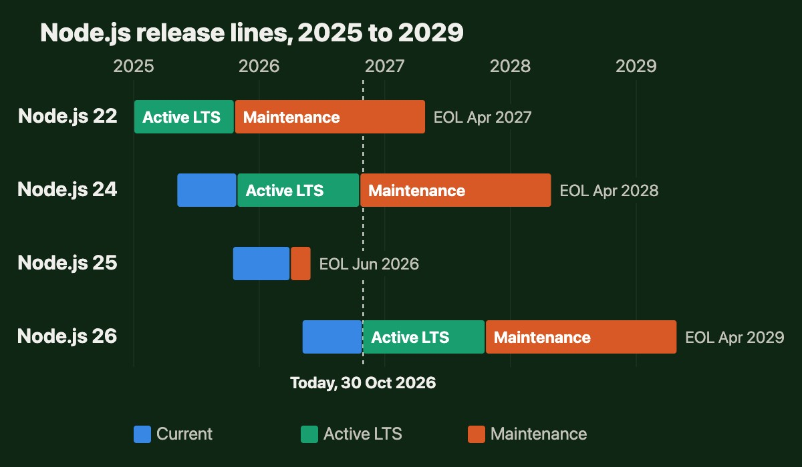
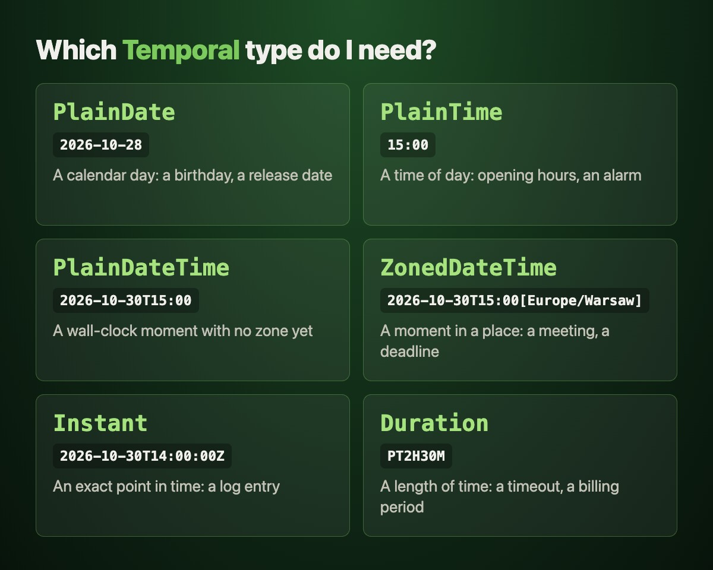

On 28 October 2026, Node.js 26 became the [Long Term Support](https://ciunkos.com/glossary/lts-and-end-of-life) line, eight days after Node.js 24 moved into Maintenance, which means security and critical fixes only. New projects should start on 26, and Node.js 24 gets security fixes until 30 April 2028.

> [!WARNING]
> I'm not involved in the Node.js project. This post summarizes the official release notes, changelogs and docs, and links to them throughout.

> [!TLDR]
> Plan to upgrade within the next few months; Node.js 24 is safe until April 2028, so there's time to do it calmly. Most apps need a version bump, a rebuild of native addons and, on custom or distroless Linux images, `libatomic`. Run the official codemods, which rewrite removed APIs for you, then search by hand for `fs.W_OK`, which now fails silently. In return you get Temporal, new JavaScript from V8 14.6, and Node.js 26 support until 30 April 2029.

Because 26 includes everything from the short-lived Node.js 25, the jump covers two releases. JavaScript gets Temporal, a date and time API that handles time zones, the V8 engine brings a handful of language features, and a few long-deprecated APIs are gone. If you only need the migration steps, skip to [Breaking changes](#breaking-changes) or the [checklist](#checklist).

## Release schedule {#schedule}

[Node.js 26.13.0 'Lithium'](https://nodejs.org/en/blog/release/v26.13.0) is the same code as 26.12.1 with the [LTS](https://ciunkos.com/glossary/lts-and-end-of-life) label switched on. Every LTS line gets a codename. If you've been testing on 26 already, nothing new will surprise you. You can check which line you're on:

```javascript
console.log(process.version, process.release.lts)
// v26.13.0 Lithium
```

Where each line stands, per the [Node.js release schedule](https://github.com/nodejs/Release):

- Node.js 26 is Active LTS until 20 October 2027, then gets maintenance fixes until its end of life on 30 April 2029.
- Node.js 24 has been in Maintenance since 20 October 2026, which means security and critical bug fixes only, until 30 April 2028.
- Node.js 22 has been in Maintenance since October 2025 and reaches end of life on 30 April 2027. If you're still on 22, it's the more urgent upgrade.
- Node.js 25, the odd-numbered release in between, reached end of life in June 2026.



You have a year and a half before Node.js 24 stops getting security patches, so nobody needs to upgrade tonight. But Temporal, the new JavaScript features and network restrictions in the permission model won't be backported to 24. Upgrading while 24 still has 18 months left also leaves you room to roll back if something goes wrong. Waiting for the next LTS doesn't buy much either, because Node.js 27 only becomes LTS in October 2027.

## Temporal is here {#temporal}


[`Date`](https://developer.mozilla.org/en-US/docs/Web/JavaScript/Reference/Global_Objects/Date) has been JavaScript's most apologized-for API since 1995. It's mutable, so passing a date into a function can change it behind your back. It can only do math in UTC and the server's local time zone; any other zone is formatting only. And it can't represent a plain calendar date, like a birthday, without inventing a time of day you never asked for.

[Temporal](https://developer.mozilla.org/en-US/docs/Web/JavaScript/Reference/Global_Objects/Temporal) fixes all three. Its values are immutable, it does math in any time zone by name, and it has separate types for separate ideas: `PlainDate` for a calendar day, `ZonedDateTime` for a moment in a specific place, `Duration` for a span of time. In Node.js 26 it's a global, on by default:

```javascript
const release = Temporal.PlainDate.from('2026-10-28')
const endOfLife = Temporal.PlainDate.from('2029-04-30')

release.until(endOfLife, { largestUnit: 'years' }).toString()
// 'P2Y6M2D' - 2 years, 6 months and 2 days

const warsaw = '2026-10-30T15:00[Europe/Warsaw]'
const meeting = Temporal.ZonedDateTime.from(warsaw)
meeting.withTimeZone('America/Los_Angeles').toPlainTime().toString()
// '07:00:00' - 8 hours behind this week, not the usual 9,
// because the US leaves summer time a week after Europe

Temporal.Duration.from({ hours: 1, minutes: 90 })
  .round({ largestUnit: 'hours' })
  .toString()
// 'PT2H30M'
```

The hardest part of Temporal is choosing a type, so match it to what you know. A day with no time, like a birthday, is a `PlainDate`. A date, a time and a time zone, like a 15:00 meeting in Warsaw, make a `ZonedDateTime`. A point in time with no place, like a log timestamp, is an `Instant`.



Existing code doesn't have to switch in one go. Every valid `Date` converts with [`toTemporalInstant()`](https://developer.mozilla.org/en-US/docs/Web/JavaScript/Reference/Global_Objects/Date/toTemporalInstant), (an invalid one throws a `RangeError`), and since 26.2.0 [file stats](https://nodejs.org/docs/latest-v26.x/api/fs.html#class-fsstats) come with `Temporal.Instant` fields next to the old `Date` ones:

```javascript
import { statSync } from 'node:fs'

const legacy = new Date('2026-10-28T12:00:00Z')
const instant = legacy.toTemporalInstant()
instant.toZonedDateTimeISO('Europe/Warsaw').toString()
// '2026-10-28T13:00:00+01:00[Europe/Warsaw]'

const { mtimeInstant } = statSync('package.json')
mtimeInstant instanceof Temporal.Instant // true
```

If you use `date-fns`, `dayjs` or `luxon` only for time zones and date math, Temporal can likely replace them. If the same code still has to run on Node.js 24, which doesn't enable Temporal, keep the library or load a polyfill such as [`temporal-polyfill`](https://www.npmjs.com/package/temporal-polyfill). The [Temporal cookbook](https://tc39.es/proposal-temporal/docs/cookbook.html) has recipes for the common cases.

## What's new since Node.js 24 {#whats-new}

Node.js 26 ships V8 14.6 (up from 13.6) and [Undici](https://github.com/nodejs/undici) 8 behind the built-in [`fetch()`](https://developer.mozilla.org/en-US/docs/Web/API/Window/fetch). npm stays on version 11. Node.js 24 kept getting backports through 2026, so this section compares against the latest 24.x release, and [a separate section](#helpers) lists what you get if your 24 is older.

### New JavaScript {#v8}

A common loop looks up a key, creates a default if it's missing, then updates it. V8 14.6 gives `Map` and `WeakMap` [`getOrInsert()`](https://developer.mozilla.org/en-US/docs/Web/JavaScript/Reference/Global_Objects/Map/getOrInsert) and [`getOrInsertComputed()`](https://developer.mozilla.org/en-US/docs/Web/JavaScript/Reference/Global_Objects/Map/getOrInsertComputed) for that:

```javascript
const byAuthor = new Map()
for (const [author, title] of [
  ['ada', 'Temporal'],
  ['lin', 'UUIDv7'],
  ['ada', 'using']
]) {
  byAuthor.getOrInsertComputed(author, () => []).push(title)
}
// Map(2) { 'ada' => ['Temporal', 'using'], 'lin' => ['UUIDv7'] }
```

The computed version only calls the factory when the key is missing. `getOrInsert(author, [])` would build a new empty array on every iteration and throw most of them away.

[`Iterator.concat()`](https://developer.mozilla.org/en-US/docs/Web/JavaScript/Reference/Global_Objects/Iterator/concat) stitches several iterables into one lazy iterator. Nothing is copied, and you can chain the [iterator helpers](https://developer.mozilla.org/en-US/docs/Web/JavaScript/Reference/Global_Objects/Iterator) straight onto it:

```javascript
function* drafts() {
  yield 'draft-1'
}

Iterator.concat(['a', 'b'], drafts())
  .map(name => name.toUpperCase())
  .toArray()
// ['A', 'B', 'DRAFT-1']
```

`Uint8Array` converts to and from base64 and hex on its own, with [`fromBase64()`](https://developer.mozilla.org/en-US/docs/Web/JavaScript/Reference/Global_Objects/Uint8Array/fromBase64) and [`toHex()`](https://developer.mozilla.org/en-US/docs/Web/JavaScript/Reference/Global_Objects/Uint8Array/toHex). That helps code shared with the browser, which has no `Buffer`:

```javascript
const bytes = Uint8Array.fromBase64('SGVsbG8sIE5vZGUgMjY=')
new TextDecoder().decode(bytes) // 'Hello, Node 26'
new Uint8Array([1, 255]).toHex() // '01ff'
new Uint8Array([1, 255]).toBase64() // 'Af8='
```

V8 also made [`JSON.stringify` faster](https://v8.dev/blog/json-stringify) for plain objects. You get that one without changing any code.

### Web Storage {#web-storage}

[`localStorage` and `sessionStorage`](https://developer.mozilla.org/en-US/docs/Web/API/Web_Storage_API) no longer need a flag, though the API is still a release candidate, Node's label for stable-but-not-final. `sessionStorage` lives in memory for the life of the process. `localStorage` persists to a file you choose, which suits CLIs and code shared with the browser. Treat it as a small key-value file. The data is stored unencrypted, capped at 10 MB, and in a server it's shared across all users and requests:

```bash
node --localstorage-file=./storage.db app.js
```

```javascript
localStorage.setItem('theme', 'dark')
localStorage.getItem('theme') // 'dark', even after a restart
```

[`ErrorEvent`](https://developer.mozilla.org/en-US/docs/Web/API/ErrorEvent) is a global now, and an experimental Web Worker API sits behind `--experimental-web-worker` for code shared with the browser. One catch with `localStorage` on the server is covered in [the breaking changes](#localstorage).

### Network permissions {#permissions}

The [permission model](https://nodejs.org/docs/latest-v26.x/api/permissions.html) can now restrict network access. With `--permission` on, network calls fail with `ERR_ACCESS_DENIED` unless you pass `--allow-net`, which is still experimental. For `fetch()`, the code sits in `err.cause`:

```bash
node --permission --allow-fs-read=./ --allow-net app.js
```

Audit mode, [`--permission-audit`](https://nodejs.org/docs/latest-v26.x/api/cli.html#--permission-audit), arrived in 24.20 too. It runs every check without denying anything and publishes each violation on `diagnostics_channel`, Node's built-in event bus, so you can collect the list before you enforce it.

Keep two things in mind. The docs call the permission model a seat belt for trusted code, and say plainly that malicious code can get around it. And under `--permission`, child processes, worker threads and native addons are blocked too, until you add `--allow-child-process`, `--allow-worker` or `--allow-addons`.

### Tooling and experiments {#tooling}

- New in 26.11.0, [`--process-timeout=30s`](https://nodejs.org/docs/latest-v26.x/api/cli.html#--process-timeoutduration) stops a process that is still running after 30 seconds with exit code 124, like the Unix `timeout` command, and first prints which handles kept it alive. It's useful for scripts and CI jobs that finish their work and then hang.
- `node --build-sea=sea-config.json` builds a [single executable application](https://nodejs.org/docs/latest-v26.x/api/single-executable-applications.html) (SEA), your app and Node.js in one binary, in one step. SEA now supports ESM entry points.
- `node:zlib` can read and write ZIP archives with [`ZipFile`](https://nodejs.org/docs/latest-v26.x/api/zlib.html#class-zlibzipfile) and `ZipBuffer`, in early development.
- Alpine Linux moved to tier 2 support in 26.11.0, which means full CI coverage, and nodejs.org now publishes an official `linux-x64-musl` build, the one Alpine needs, next to the glibc builds.
- [`node:ffi`](https://nodejs.org/docs/latest-v26.x/api/ffi.html) calls native libraries without writing a C++ addon. It's experimental but on by default since 26.9.0, and under `--permission` it needs `--allow-ffi`. Still behind flags: `node:vfs` for virtual file systems, `node:bench` for benchmarks and an iterable streams API.

## Already in recent Node.js 24 releases {#helpers}

Several features from Node.js 25 and 26 were backported to 24.x, in releases 24.14 to 24.22. If you're upgrading from an older 24, these are new to you too.

[Debounce](https://developer.mozilla.org/en-US/docs/Glossary/Debounce) and [throttle](https://developer.mozilla.org/en-US/docs/Glossary/Throttle) are built into `node:util`, and [UUIDv7](https://nodejs.org/docs/latest-v26.x/api/crypto.html#cryptorandomuuidv7options) into `node:crypto`:

```javascript
import { writeFile } from 'node:fs/promises'
import { debounce } from 'node:util'
import { randomUUIDv7 } from 'node:crypto'

const save = debounce(text => writeFile('draft.txt', text), 500)
save('H')
save('He')
await save('Hello')
// one write of 'Hello', and all three calls resolve with its result

randomUUIDv7() // '01a18c3b-414f-76ff-9865-53facb82bd1e'
```

The options differ from lodash's, so read the [`util.debounce()`](https://nodejs.org/docs/latest-v26.x/api/util.html#utildebouncefn-wait-options) docs before you swap it in. [`util.throttle()`](https://nodejs.org/docs/latest-v26.x/api/util.html#utilthrottlefn-limit-interval-options) is a rate limiter, `throttle(fn, limit, interval)`, that allows a number of calls per interval, unlike lodash's `throttle(fn, wait)`.

If you use UUIDs as primary keys, generate [v7](https://www.rfc-editor.org/rfc/rfc9562.html#name-uuid-version-7) for new rows. A v4 UUID lands at a random spot in the index on every insert. A v7 UUID starts with a timestamp, so new rows land near the end of a B-tree index and inserts stay mostly sequential. The trade-off is that anyone who sees the ID can read when the row was created.

Also backported to 24:

- Incoming HTTP requests have [`req.signal`](https://nodejs.org/docs/latest-v26.x/api/http.html#messagesignal), an [`AbortSignal`](https://developer.mozilla.org/en-US/docs/Web/API/AbortSignal) that fires when the client disconnects. Pass it to `fetch()` or a database query, and the work stops when nobody is waiting for it.
- `process.permission.drop()` lets a process give up permissions it no longer needs, for example after reading its config files.
- `node --test --test-randomize` runs tests in random order to expose tests that only pass because another one ran first. The [test runner](https://nodejs.org/docs/latest-v26.x/api/test.html) can also mark tests as expected to fail, and `context.log()` writes into the report.
- [Subpath imports](https://nodejs.org/docs/latest-v26.x/api/packages.html#subpath-imports) can start with `#/`, so `#/utils/date.js` can map straight onto your `src` folder.
- [`util.styleText()`](https://nodejs.org/docs/latest-v26.x/api/util.html#utilstyletextformat-text-options) accepts hex colors, like `styleText('#ff8800', 'warning')`.

## Breaking changes {#breaking-changes}

Most applications upgrade without touching their code. The breaks below are roughly in order of how likely they are to hit you, with the error message where there is one.

To see which ones apply to you, run a quick check from the root of your repository:

- `ldd $(command -v node) | grep atomic` inside your image or server shows `not found` if [libatomic](#libatomic) is missing.
- `git grep -n corepack` finds [Corepack](#corepack) in your Dockerfiles and CI.
- `find node_modules -name '*.node'` lists compiled [native addons](#native-addons).
- The search in [checklist step 7](#checklist) finds [removed APIs](#removed-apis).
- `git grep -n experimental-transform-types` finds the [removed TypeScript flag](#typescript).
- `git grep -n "'localStorage' in"` finds the [localStorage check](#localstorage) that now breaks.
- `git grep -nE "module\.register|register\("` finds [custom loaders](#module-register).

If none of these match, the upgrade is mostly a version bump.

### Missing libatomic {#libatomic}

Since Node.js 25, the official Linux binaries link against `libatomic`, a small system library for atomic operations. The official [`node:26` Docker images](https://github.com/nodejs/docker-node) (Debian slim and Alpine) already install it. Custom images, distroless setups and machines where you unpack the tarball yourself may not, and there `node` exits before running a line of your code:

```text
node: error while loading shared libraries: libatomic.so.1: cannot open shared object file: No such file or directory
```

Install it in your image:

```bash
# Debian, Ubuntu
apt-get install -y libatomic1

# Fedora, RHEL
dnf install -y libatomic

# Alpine
apk add libatomic
```

### Corepack is gone {#corepack}

Node.js 25 stopped shipping [Corepack](https://github.com/nodejs/corepack). If your CI or Dockerfile runs `corepack enable` to get pnpm or Yarn, the command no longer exists. Install it from npm first:

```bash
npm install --global corepack
corepack enable
```

Or skip Corepack and install the package manager directly with `npm install --global pnpm`.

### Native addons need a rebuild {#native-addons}

The native module ABI, the binary interface compiled addons link against, moved from `NODE_MODULE_VERSION` 137 in Node.js 24 to 147, per the [ABI version registry](https://github.com/nodejs/node/blob/main/doc/abi_version_registry.json). Addons built on [Node-API](https://nodejs.org/docs/latest-v26.x/api/n-api.html), Node's stable C API, keep working. Addons compiled against V8 directly, or through NAN, the older C++ helper library, fail to load with a message like this:

```text
was compiled against a different Node.js version using
NODE_MODULE_VERSION 137. This version of Node.js requires
NODE_MODULE_VERSION 147.
```

Delete `node_modules` and install again, or rebuild in place:

```bash
npm rebuild
```

A reinstall only rebuilds if install scripts run. With pnpm 10, which skips dependency build scripts unless you allow them, or with `--ignore-scripts` in CI, allow the builds first. A compile error usually means the package needs a newer version of NAN. If a package has no build for Node.js 26 yet, update it. If it's abandoned, look for a pure JavaScript or WebAssembly replacement.

### Removed APIs {#removed-apis}

These were [deprecated](https://nodejs.org/docs/latest-v26.x/api/deprecations.html), most of them for years, and are now gone. Each has a short fix, and several have an [official codemod](https://github.com/nodejs/userland-migrations) that makes the change for you. Codemods rewrite files in place, so run them from the repository root on a clean git tree and review the diff.

Start with the `fs` access constants, because this one fails silently. `fs.R_OK`, `fs.W_OK` and `fs.X_OK` are now `undefined`, and `fs.accessSync(file, undefined)` only checks that the file exists. A permission check that used them still passes on Node.js 26, even for a read-only file.

Destructuring with `require` fails just as silently. Only an ESM named import, `import { W_OK } from 'node:fs'`, fails loudly, with a `SyntaxError` at load. `fs.F_OK` is gone too, but it was the default anyway. Move to [`fs.constants`](https://nodejs.org/docs/latest-v26.x/api/deprecations.html#DEP0176):

```javascript
// before: on Node.js 26 this passes even if the file is read-only
fs.accessSync(file, fs.W_OK)
// after
fs.accessSync(file, fs.constants.W_OK)
```

```bash
npx codemod@latest @nodejs/fs-access-mode-constants
```

[`SlowBuffer`](https://nodejs.org/docs/latest-v26.x/api/deprecations.html#DEP0030) is gone. CommonJS code using it throws `TypeError: SlowBuffer is not a constructor`, and an ESM `import { SlowBuffer } from 'node:buffer'` fails at load with a `SyntaxError`. Use `Buffer.allocUnsafeSlow()`:

```bash
npx codemod@latest @nodejs/slow-buffer-to-buffer-alloc-unsafe-slow
```

The [`recursive` option of `fs.rmdir()`](https://nodejs.org/docs/latest-v26.x/api/deprecations.html#DEP0147) now throws `The property 'options.recursive' is no longer supported`. Use `fs.rm()`:

```javascript
// before
fs.rmdirSync(dir, { recursive: true })
// after
fs.rmSync(dir, { recursive: true, force: true })
```

```bash
npx codemod@latest @nodejs/rmdir
```

The [internal `_stream_*` modules](https://nodejs.org/docs/latest-v26.x/api/deprecations.html#DEP0193), like `_stream_readable` and `_stream_writable`, are gone too. You'll rarely find these in your own code. When you see `Cannot find module '_stream_readable'`, an old dependency needs an update:

```javascript
// before
const Readable = require('_stream_readable')
// after
const { Readable } = require('node:stream')
```

[`response.writeHeader()`](https://nodejs.org/docs/latest-v26.x/api/deprecations.html#DEP0063) was never documented, but old code still calls it, and it now throws `res.writeHeader is not a function`. Use `response.writeHead()`.

Also removed: `assert.CallTracker` (use `mock.fn()` from `node:test`), the `multipleResolves` process event, `assert.fail()` with more than one argument, the callback of `worker.terminate()` (it returns a promise) and creating `node:repl` classes without `new`.

### No more --experimental-transform-types {#typescript}

Running `.ts` files directly still works, because type stripping is stable. What's gone is the flag that also transformed enums, namespaces and parameter properties:

```text
$ node --experimental-transform-types app.ts
node: bad option: --experimental-transform-types
```

Without it, Node.js rejects that syntax with `ERR_UNSUPPORTED_TYPESCRIPT_SYNTAX`. You have two ways out. Replace enums with plain objects and turn on [`erasableSyntaxOnly`](https://www.typescriptlang.org/tsconfig/#erasableSyntaxOnly) and `verbatimModuleSyntax` in `tsconfig.json`, so the compiler flags anything Node.js can't strip. Or run through a loader, `node --import=tsx app.ts`, or compile with `tsc` or `esbuild` first. Node.js itself ignores `tsconfig.json`, so `paths` aliases don't work with plain type stripping.

```typescript
// before
enum Status {
  Draft,
  Published
}

// after
const Status = { Draft: 0, Published: 1 } as const
type Status = typeof Status[keyof typeof Status]
```

The object version has no reverse mapping, so `Status[0]` no longer gives you `'Draft'`.

### localStorage exists on the server {#localstorage}

With Web Storage on by default, `globalThis` has a [`localStorage`](https://nodejs.org/docs/latest-v26.x/api/globals.html#localstorage) property on the server. Unless you pass `--localstorage-file`, its value is `undefined`, and reading it prints `ExperimentalWarning: localStorage is not available because --localstorage-file was not provided`. Code that detects the browser by checking for the property now takes the wrong branch and crashes with `TypeError: Cannot read properties of undefined (reading 'getItem')`. The `globals` docs still say this access throws a `DOMException`, but the 26.0.0 changelog and 26.13.0 itself return `undefined`:

```javascript
// breaks: the property exists, but its value is undefined
if ('localStorage' in globalThis) {
  localStorage.getItem('token')
}

// works
if (typeof window !== 'undefined') {
  localStorage.getItem('token')
}
```

If your tests mock `localStorage`, for example with `jest-localstorage-mock`, or run in jsdom, check that the mock still replaces the new global. If you don't want Web Storage on the server at all, run Node.js with `--no-experimental-webstorage`.

### module.register() is deprecated {#module-register}

Custom loaders registered with `module.register()` still work, but every run now prints a [`DEP0205`](https://nodejs.org/docs/latest-v26.x/api/deprecations.html#DEP0205) warning. The replacement, [`module.registerHooks()`](https://nodejs.org/docs/latest-v26.x/api/module.html#moduleregisterhooksoptions), is a release candidate rather than stable. It runs synchronously on the main thread and handles both `import` and `require()`:

```javascript
import { register, registerHooks } from 'node:module'

// before: async hooks in a separate file, off the main thread
register('./hooks.mjs', import.meta.url)

// after: synchronous hooks, in a file loaded with node --import
registerHooks({
  resolve(specifier, context, nextResolve) {
    return nextResolve(specifier, context)
  }
})
```

Hooks only apply to modules loaded after they're registered, so keep them in their own file and load it first with `node --import ./register-hooks.js app.js`. A `load` hook that awaits a file read has to switch to `readFileSync`. The object `registerHooks()` returns has a `deregister()` method, and since 26.7.0 it also works with `using` when you only need the hooks inside one block. If the loader comes from a tool like `tsx` or your test runner, updating the tool is usually enough.

### Smaller changes {#smaller-changes}

- If you already run with `--permission`, network access is now denied by default. `fetch()` and other network calls fail with `ERR_ACCESS_DENIED` until you add [`--allow-net`](#permissions).
- `assert.deepStrictEqual()` and `util.isDeepStrictEqual()` now fail when comparing two different promises, and treat two invalid dates as equal.
- `crypto.createHash('shake256')` without an `outputLength` prints a [`DEP0198`](https://nodejs.org/docs/latest-v26.x/api/deprecations.html#DEP0198) deprecation warning, so pass the length explicitly.
- Passing a Web Crypto `CryptoKey` to `node:crypto` functions like `createHmac()` or `sign()` is [deprecated](https://nodejs.org/docs/latest-v26.x/api/deprecations.html#DEP0203) and will throw in a future version.
- AES-GCM decryption with an authentication tag shorter than 16 bytes needs an explicit `authTagLength`.
- In 26.11.0, [`node:sqlite`](https://nodejs.org/docs/latest-v26.x/api/sqlite.html) renamed `DatabaseSync` to `Database` and `StatementSync` to `Statement`. The old names still work as deprecated aliases.
- Building Node.js from source needs GCC 13.2 and Python 3.10 or newer, and Power 8 and z13 CPUs are no longer supported.
- The project has warned that macOS universal binaries, with Intel and Apple Silicon in one file, may not last for the whole life of Node.js 26 as Apple drops Intel support.

## Upgrade checklist {#checklist}

1. Add Node.js 26 to the CI matrix next to 24 and fix what fails before you switch the default.
2. Install Node.js 26 (for example `nvm install 26`) and bump the version everywhere it's pinned: `.nvmrc`, `.node-version`, your Dockerfile (`FROM node:26`) and, for apps, the `engines` field in `package.json`. Libraries keep their lower bound.
3. If you use TypeScript, bump `@types/node` to 26 and use TypeScript 6 or newer with `"lib": ["esnext"]`, which includes the Temporal types.
4. Install [`libatomic`](#libatomic) on Linux machines and images that lack it.
5. Replace `corepack enable` with a [global install](#corepack), if you use Corepack.
6. Delete `node_modules`, install again, and let [native addons](#native-addons) rebuild. Then run `npx ls-engines` to find dependencies whose `engines` field excludes Node.js 26.
7. Run the official codemods for the [removed APIs](#removed-apis), then search for what's left by hand, since `fs.R_OK`, `fs.W_OK` and `fs.X_OK` fail silently. This lists every candidate for you to check, and skips files git ignores:

   ```bash
   git grep -nwE "[RWX]_OK|SlowBuffer|_stream_[a-z]+|writeHeader|rmdir(Sync)?"
   ```

8. Run your tests with `node --trace-deprecation` to see which code, yours or a dependency's, triggers each warning. Once you've fixed or updated what you can, gate CI with `NODE_OPTIONS=--throw-deprecation`.
9. Deploy to staging and watch for `DeprecationWarning` and `ExperimentalWarning` before you go to production.
10. If you maintain a library, keep Node.js 24 in the CI matrix until it reaches end of life in April 2028, and Node.js 22 until April 2027.

## FAQ {#faq}

### Is Node.js 26 an LTS release? {#faq-lts}

Yes. Node.js 26 became the Active LTS release with version 26.13.0 'Lithium' on 28 October 2026. It stays in Active LTS until 20 October 2027 and receives maintenance fixes until its end of life on 30 April 2029.

### When does Node.js 24 reach end of life? {#faq-node-24-eol}

Node.js 24 moved to Maintenance on 20 October 2026 and reaches end of life on 30 April 2028. Until then it gets security and critical bug fixes only, with no new features.

### Should I upgrade from Node.js 24 to 26 now? {#faq-upgrade-now}

Start new projects on Node.js 26 today. For existing apps, plan the upgrade within the next few months rather than waiting for April 2028, while there's still time to roll back. The [self-check](#breaking-changes) shows which breaks apply to you, and the [upgrade checklist](#checklist) covers the steps.

### Is Temporal available in Node.js 26 without a flag? {#faq-temporal}

Yes. Temporal is enabled by default in Node.js 26 and available as a global, with no flag or import needed. Node.js 24 doesn't enable it.

### What breaks when upgrading from Node.js 24 to 26? {#faq-breaking}

The usual suspects are `libatomic` on custom or distroless Linux images, the missing Corepack, native addons built against V8 directly, and removed APIs like `SlowBuffer` and `fs.R_OK`, the last of which fails silently. [Breaking changes](#breaking-changes) covers each one with its fix.

### Do I need to rebuild native addons for Node.js 26? {#faq-native-modules}

Only if they aren't built on Node-API. Addons compiled against V8 directly, or through NAN, need a rebuild for `NODE_MODULE_VERSION` 147, up from 137 in Node.js 24. Node-API addons keep working. Run `npm rebuild` or reinstall your dependencies, and update any package that has no Node.js 26 build yet.

## Need a hand? {#hire}

In a large or long-lived Node.js codebase these changes pile up, in native addons, custom loaders, old dependencies on removed internals and a CI matrix with five places to bump. That's the kind of work I take on for clients. If you'd rather hand it off, [see how I work](https://ciunkos.com/hire-me).

## Sources {#sources}

- [Node.js 26.13.0 'Lithium' (LTS) release](https://nodejs.org/en/blog/release/v26.13.0)
- [Node.js 26.0.0 release](https://nodejs.org/en/blog/release/v26.0.0)
- [Node.js 25.0.0 release](https://nodejs.org/en/blog/release/v25.0.0)
- [Node.js 26 changelog](https://github.com/nodejs/node/blob/main/doc/changelogs/CHANGELOG_V26.md)
- [Node.js 24 changelog](https://github.com/nodejs/node/blob/main/doc/changelogs/CHANGELOG_V24.md)
- [Deprecated APIs](https://nodejs.org/docs/latest-v26.x/api/deprecations.html)
- [Official codemods](https://github.com/nodejs/userland-migrations)
- [Temporal documentation](https://tc39.es/proposal-temporal/docs/)
